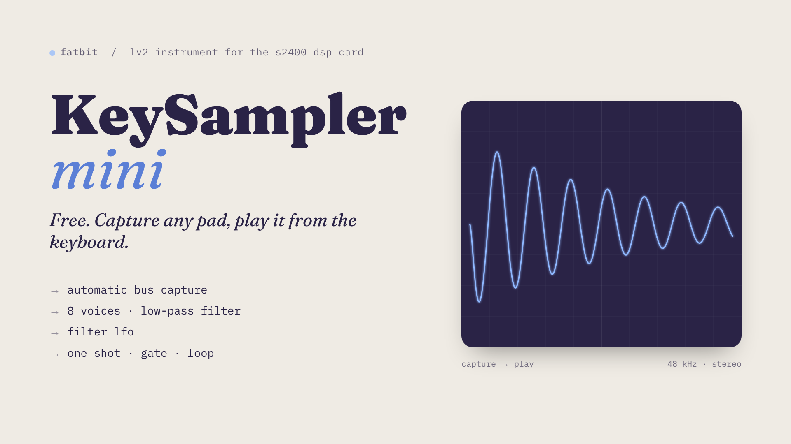
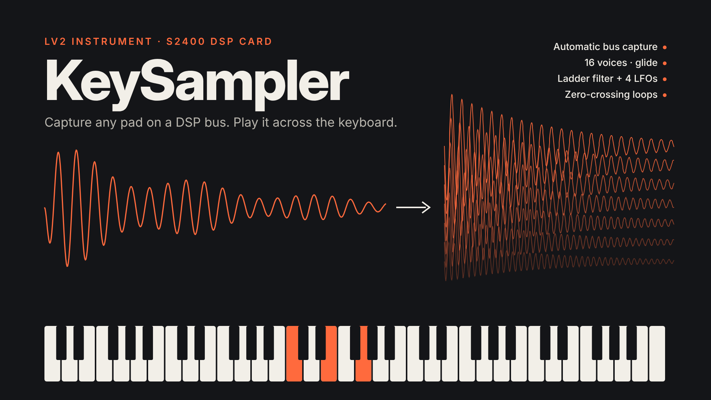
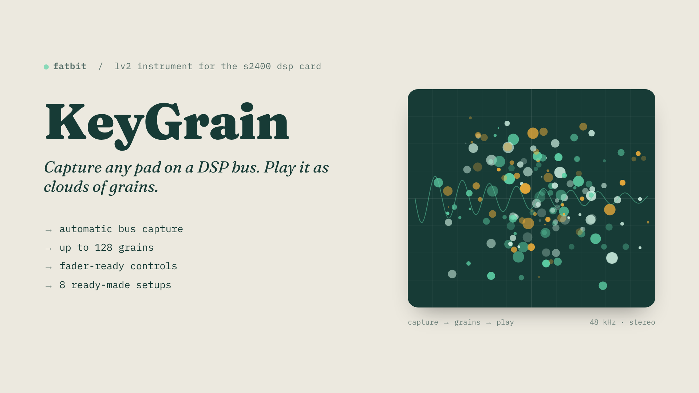

# KeySampler-mini — free sampler instrument for the ISLA S2400 DSP Card

**Turn any S2400 pad into a playable instrument, free.** KeySampler-mini is an LV2 instrument
for the ISLA S2400 DSP Card. Put it on a DSP bus, hit a pad, and the sound is captured
automatically — then play it chromatically from your MIDI keyboard. Every new sound that reaches
the bus replaces the old one. No resampling, no file management.

## Features

- **Automatic capture** from the DSP bus into memory (up to 30 s): starts when sound arrives,
  ends when it has finished, then replaces the sound you play
- **Bus Capture** On / On Mute / Off: capture and hear the bus, capture silently, or keep the current sound and ignore the bus
- **8 voices**, velocity (with sensitivity), pitch bend, sustain pedal
- **One Shot, Gate and Loop** play modes with Start and loop points in the S2400's own
  sec / ms format, automatically moved to zero crossings so starts and loops don't click
- **Volume envelope** (Attack, Decay, Sustain, Release)
- **Moog-style 24 dB/oct low-pass ladder filter** per voice, with resonance up to
  self-oscillation and its own envelope (Amount, Attack, Decay, Sustain, Release)
- **Filter LFO** with sine, triangle, square, saw and random waves, rate, depth and delay
- Level, Tune (±24 semitones), Pan, Root Note, MIDI channel (Omni or 1–16), bend range
- All 31 parameters in the S2400's plugin menu, saved with your project

## Install

1. Download this repository (**Code → Download ZIP**) and unzip it.
2. Copy the `dspcard` folder to the root of the S2400's SD card (merge it with the one already
   there). The plugin ends up in `SD:/dspcard/plugins/lv2/keysampler-mini.lv2/`.
   On a Mac, remove Finder's hidden files before ejecting:
   `find /Volumes/<SD card>/dspcard -name ".DS_Store" -delete`
3. Put the card back, press **Shift+Effects**, select **Sync Files** in the DSP Card section,
   then switch the S2400 **off and on again**.

## Quick start

1. **Bank+0** opens the DSP Mixer. On bus 1 press **Shift+Pad**, choose **+Add Plugin/Preset**
   and pick **KeySampler-mini** (vendor *KeySampler*).
2. Hold **Shift** and press the pad you want to play to open Track Settings; set **Output** to 1.
3. Hit the pad once. KeySampler-mini captures it (you hear it because Bus Capture is On).
4. Play your MIDI keyboard on the bus's MIDI channel (channel 1 for bus 1). Middle C (Root Note 60)
   plays the sound at its original pitch.

Set **Bus Capture** to On Mute to capture new sounds silently, or Off to keep the current sound. The captured sound lives in memory only:
after power-off, hit the pad again to capture it.

## Manual

KeySampler-mini shares the KeySampler manual: **[KeySampler manual (PDF)](docs/KeySampler_Manual.pdf)**.
Chapter 12 lists the mini's menu and what it leaves out; sections and parameters marked
*not in mini* apply to the full KeySampler only.

## Want more? KeySampler and KeyGrain

KeySampler-mini is the free little brother of **KeySampler**. Its sister plugin, **KeyGrain**,
plays the same captured sounds as clouds of grains.

### KeySampler — the full version

Everything in the mini, plus:

- **16 voices**, **portamento and legato glide**
- **Ping-Pong** loops
- **Band-pass and high-pass** filter modes
- **Four LFOs** — volume (tremolo), filter, pitch (vibrato) and pan (auto-pan) — all at once
- Built-in **sine, triangle, square and saw** oscillators
- **Key range**: set the lowest and highest key by pressing them
- **Full MIDI control** following General MIDI 2, remappable in a text file; knob moves can be
  saved into the S2400 menu
- PDF manual — [read it here](docs/KeySampler_Manual.pdf)

**[→ Buy KeySampler](https://buy.polar.sh/polar_cl_rD8J6OsCse0SCoi9mde7zXRO7wmlaW5Cn0vhR3Vludf)**

### KeyGrain — granular synthesis for the S2400

Capture any pad and play it as pads, textures and drones:

- Up to **128 grains**, Hann / Triangle / Trapezoid windows
- **Position, Spray, Grain size, Density, Pitch randomness, Scan, Stereo spread and Level** laid
  out for faders 1–8
- Self-moving **Scan** and **reverse grains** for evolving textures
- 16 voices, velocity, pitch bend, key range
- **8 ready-made DSP setups** with faders and knobs already assigned
- PDF manual — [read it here](docs/KeyGrain_Manual.pdf)

**[→ Buy KeyGrain](https://buy.polar.sh/polar_cl_yvwXAcWo8HUyTZewYYK5GQ7O7UNUYW2GPMV9C16kL1X)**

| | KeySampler-mini | KeySampler | KeyGrain |
|---|:---:|:---:|:---:|
| Automatic capture from the DSP bus | ✓ | ✓ | ✓ |
| Voices | 8 | 1–16 | 1–16 |
| Play modes | One Shot, Gate, Loop | + Ping-Pong | granular |
| Filter | Low pass | Low, band, high pass | — |
| LFOs | Filter | Volume, filter, pitch, pan | — |
| Glide (portamento / legato) | — | ✓ | — |
| Built-in oscillators | — | ✓ | — |
| Key range | — | ✓ | ✓ |
| MIDI CC control | — | ✓ (GM2, remappable) | via S2400 controls |
| Manual | [shared with KeySampler](docs/KeySampler_Manual.pdf) | [✓](docs/KeySampler_Manual.pdf) | [✓](docs/KeyGrain_Manual.pdf) |
| Price | **free** | [buy](https://buy.polar.sh/polar_cl_rD8J6OsCse0SCoi9mde7zXRO7wmlaW5Cn0vhR3Vludf) | [buy](https://buy.polar.sh/polar_cl_yvwXAcWo8HUyTZewYYK5GQ7O7UNUYW2GPMV9C16kL1X) |

Payments are handled by [Polar](https://polar.sh). You download the plugin and manual right after
purchase; your personal license file follows by email.

## Requirements

ISLA S2400 with the DSP Card. Tested with DSP Card firmware 3.1.12.

## Licence

KeySampler-mini is **freeware**: © 2026 fatbit. You may use it and share it unmodified and free of
charge; see [LICENSE.txt](LICENSE.txt). Third-party components:
[THIRD_PARTY_NOTICES.txt](THIRD_PARTY_NOTICES.txt).

KeySampler-mini is an independent product and is not made, endorsed or supported by
ISLA Instruments. ISLA Instruments and S2400 are trademarks of their respective owners.
